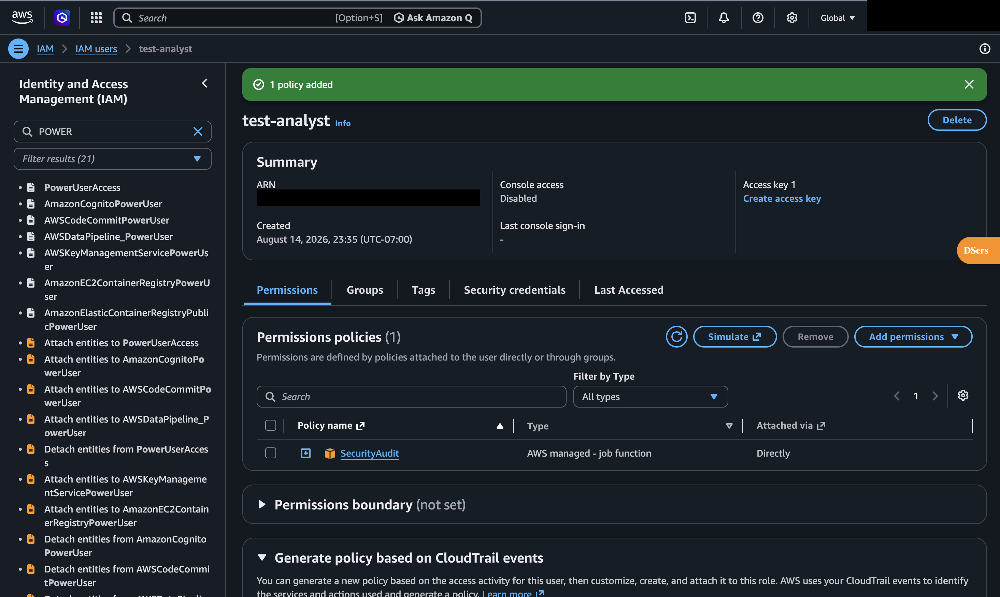
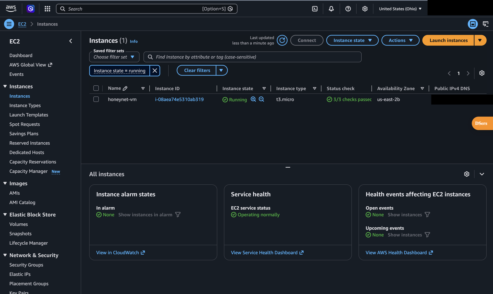
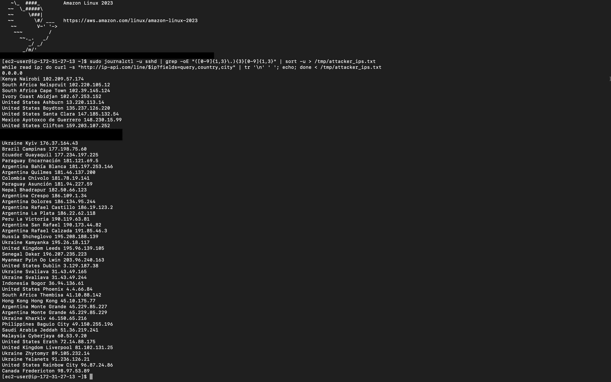
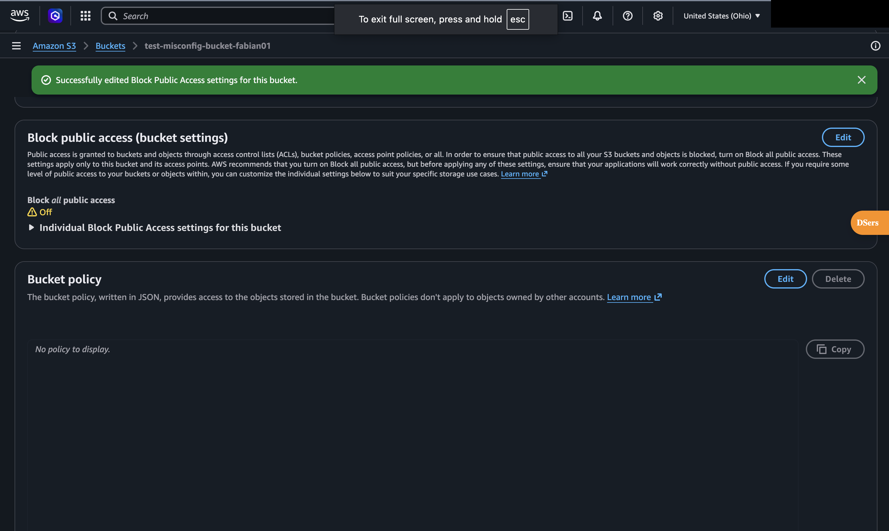

# AWS Cloud Security Lab

> Hands-on AWS security: a least-privilege IAM analyst account, an internet-exposed EC2 honeynet with Bash log analysis that traced attackers to 23 countries, and a Python/boto3 scanner that caught a misconfigured S3 bucket.

 

## Overview
| | |
|---|---|
| **Objective** | Apply least privilege, observe real-world attacks, and automate detection of cloud misconfigurations |
| **Tools** | AWS IAM, EC2 (Amazon Linux 2023), S3, AWS CLI, Python (boto3), Bash (`journalctl`, `grep`, `sort`, `curl`) |
| **Skills shown** | Cloud IAM, least privilege, honeypot deployment, log analysis, threat geolocation, security automation |
| **Region** | us-east-2 (Ohio) |

---

## Part 1: IAM Least Privilege


- Did day-to-day work from a dedicated IAM admin user instead of the root account.
- Created a **`test-analyst`** user for security reviews with:
  - **Only the AWS-managed `SecurityAudit` policy** (read-only visibility into security configurations, with no ability to change anything)
  - **Console access disabled**, which leaves no password to phish
- **Why:** an auditor needs to *see* everything but *change* nothing. That is least privilege applied to a real job function.

## Part 2: EC2 Honeynet and Attacker Analysis


- Launched **`honeynet-vm`** (t3.micro, Amazon Linux 2023) with SSH exposed to the internet and key-only authentication, so brute-force attempts could not succeed.
- Pulled every source IP out of the SSH logs and geolocated them with a Bash pipeline:

```bash
# Extract unique IPs from SSH logs
sudo journalctl -u sshd | grep -oE "([0-9]{1,3}\.){3}[0-9]{1,3}" | sort -u > /tmp/attacker_ips.txt

# Geolocate each IP
while read ip; do
  curl -s "http://ip-api.com/line/$ip?fields=query,country,city" | tr '\n' ' '; echo
done < /tmp/attacker_ips.txt
```



**Findings** (my own login IP and the instance's private IP are excluded and redacted):
| Metric | Result |
|---|---|
| Unique external source IPs | **49** |
| Countries | **23** |
| Top sources | Argentina (10), United States (8), Ukraine (7), South Africa (3) |

Many of the U.S. addresses resolve to cloud and hosting regions (Ashburn, Boydton, Santa Clara), which is typical of scanners running on rented infrastructure.

## Part 3: S3 Misconfiguration Scanner (Python + boto3)


- Deliberately created **`test-misconfig-bucket-fabian01`** with **Block Public Access turned off**, to give the scanner something to find.
- Set up the AWS CLI and wrote `s3_scanner.py` to enumerate buckets and check their public-access settings.
- **Result:** `Scanning 1 bucket(s)... Found 1 misconfiguration(s)`. The scanner correctly flagged the exposed bucket.

## Security Notes
- **No credentials are stored in this repo.** Keys come from the local AWS CLI profile, and `.gitignore` blocks `.pem`, key, and credential files.
- Account IDs, ARNs, public DNS names, and personal IPs are redacted from all screenshots.

## Key Takeaways
- An exposed SSH port gets scanned from around the world. Key-only authentication is not optional.
- Misconfiguration, not exotic exploits, is the top cause of cloud breaches, and automated checks catch it.
- Least privilege means mapping permissions to a job function, not handing out admin rights.
